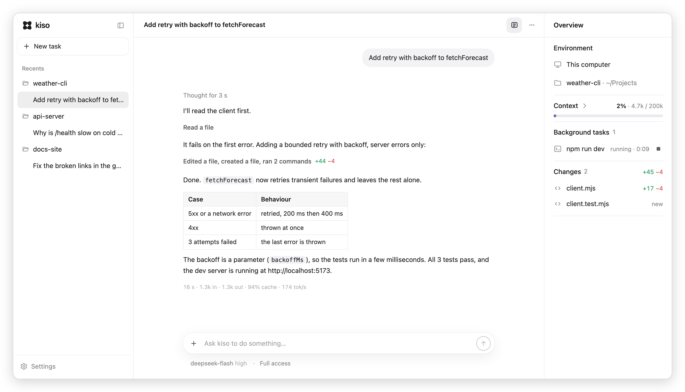
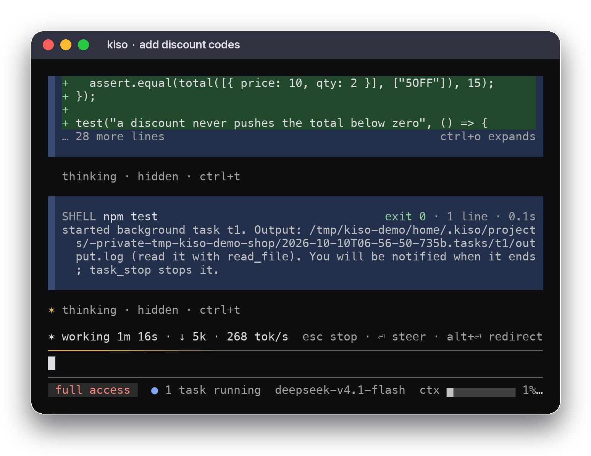
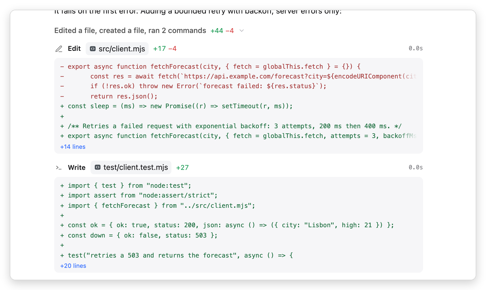

<div align="center">

<picture><source media="(prefers-color-scheme: dark)" srcset="assets/readme/lockup-dark.png"></picture>

### A coding agent that picks up where it left off.

**In your terminal or your browser. Any model you have. A `kill -9` costs you nothing.**<br>
Built on a durable agent runtime whose kernel is capped at 2,200 lines.

<b>v0.54.0</b> · Node ≥ 22 · macOS and Linux

[](https://www.npmjs.com/package/@vincemakes/kiso-code) [](https://github.com/vincemakes/kiso/actions/workflows/ci.yml) [](LICENSE)  

**[Install](#quick-start)** &nbsp;·&nbsp; **[kiso web](#kiso-web)** &nbsp;·&nbsp; **[Docs](#documentation)** &nbsp;·&nbsp; **[kiso.work](https://kiso.work)** &nbsp;·&nbsp; **English** · [简体中文](README.zh.md)

<br>



</div>

<br>

## Is kiso for you?

- **You switch models.** DeepSeek, Claude, GPT, a ChatGPT subscription, or any OpenAI-compatible endpoint or gateway, with the effort level each one accepts.
- **Your tasks are long, and things die.** A crash, a `kill -9`, a closed laptop: `kiso resume` continues from what was committed. A command whose outcome is unknown goes to you, never silently repeated.
- **You want to see where it goes.** Every turn ends with its input, output, cache hits and speed; every session is a JSONL log you can read.
- **You build agents yourself.** The runtime under it is a library: a durable session store, an agent factory and a typed event stream.

If you want a cloud agent that works while your machine is off, or Windows today, kiso is not that yet.

## Terminal or browser: one agent

<table>
<tr>
<td width="50%"></td>
<td width="50%"></td>
</tr>
<tr>
<td><b>kiso</b> in the terminal: diffs inline, background tasks in the status row, <code>?</code> for the keys.</td>
<td><b>kiso web</b> on this machine: every Work by folder, each run's changes and files beside it.</td>
</tr>
</table>

## Quick start

**1 · Install.**

```bash
npm install -g @vincemakes/kiso-code
```

<sub>Or run it without installing: `npx @vincemakes/kiso-code`. The first run needs no key: kiso plays a scripted demo turn, so you see the shape before anything is spent.</sub>

**2 · Connect a model.**

```bash
kiso login deepseek      # or anthropic / openai / zai
kiso login chatgpt       # a ChatGPT subscription: a browser sign-in, no key
kiso login --endpoint https://gateway.example/v1   # a gateway: its key, sent to it alone
```

<sub>Keys never go in the config file. Profiles, effort levels, context windows and every other option: [docs/configuration.md](docs/configuration.md).</sub>

**3 · Start.** `kiso` in a project folder, or `kiso web` for the browser (below).

## kiso web

The same agent in the browser, on this machine: a local web app with a stream of each run, its changes and files beside it, and the history of every folder's work. It is its own package, beside the terminal's:

```bash
npm install -g @vincemakes/kiso-web
kiso web
```

`kiso web` starts the host and opens the page at `http://127.0.0.1:4317` (`--port <n>` for another, `--no-open` to print the address instead). **The host must be running for the page to work:** it runs while the command runs, and with the command stopped the page cannot load. The model, the effort and the sign-in are the terminal's own (`~/.kiso/config.json`, `kiso login`). Without the package installed, `kiso web` prints the install command.

To keep it on the desktop, open the page once and add it as an app: Safari (macOS Sonoma or later), File > Add to Dock; Chrome or Edge (macOS or Linux), Install page as app. The port is fixed, so the app keeps its address; start `kiso web` before opening it. kiso web runs on macOS and Linux; Windows is not supported yet.

Sign-in is local: the command opens the page on a one-time code, which the page trades for a session cookie. **A signed-in session is a key to this machine's shell**: whoever holds it can run commands as you. The host listens on 127.0.0.1 only. `kiso web --revoke-sessions` signs every page out; each signs in again from the command.

## What it does

### It picks up where it left off

After a crash, a `kill -9` or a closed terminal, `kiso resume` continues from the durable committed prefix: generation still streaming when it died is regenerated, and a side effect whose outcome is unknown goes to a human rather than being repeated. In kiso web, the page offers the same choice the moment the host is back.

### Long tasks don't overflow

Past half the window, kiso compacts at the end of a phase, and each new summary replaces the last instead of piling up. `/context` shows what fills the window.

### Background tasks

A command still running after its wait is never killed: it becomes a background task, the model is told when it ends, and you can watch or stop it from the status row or the rail.

### Approval modes

`/mode` or `shift+tab` switches; the status row always names the mode.

| mode | does |
|---|---|
| `default` | reads and read-only shell run; writes, edits and other shell ask |
| `accept-edits` | `default`, and edits run too (except into `.git/` or `.kiso/`) |
| `plan` | reads only; everything else is refused |
| `full-access` | everything runs without asking — a user deny and the floor still hold |

A mode is one voice in a `deny > allow > ask` chain, so a saved "don't ask again" rule still allows under any mode: switching modes is not a revocation. The rules live in `~/.kiso/extensions/dont-ask-again.mjs`; delete one to be asked again. In every mode, full access included, a destructive command aimed at what cannot be recovered — `/`, your home directory, the workspace root, its `.git`, `~/.ssh` and the like — is refused. The full rules: [docs/cli.md](docs/cli.md).

### Extensions

An extension is a plain `.mjs` file — no build step. Five ship built in: MCP, skills, subagents, ask and task. Writing your own: [docs/extensions.md](docs/extensions.md).

**Which children are stripped.** The two a model can cause to run — the shell tool and an MCP server started over stdio — lose provider credentials: the known key variables, anything ending `_API_KEY` or `_AUTH_TOKEN`, and every variable a profile names in `apiKeyEnv`. NOT stripped: a subagent's child (it is kiso itself and must reach the model) and the programs you start yourself (`$EDITOR`, the sign-in browser, `kiso update`), which inherit your environment.

## Under the hood

- **Small and inspectable.** The kernel is capped at 2,200 lines (2,194 of 2,200 today); a session is a JSONL log you can read; every design decision is one of 46 ADRs, with why, and when to overturn it.
- **Measured.** Every release is benched against the one before it, paired, on the same route; the numbers are in [bench/README.md](bench/README.md).

Keys, commands and the status row: [docs/cli.md](docs/cli.md). `?` shows the keys in a session and `/help` lists the commands. `ctrl+v` attaches the clipboard image on macOS; elsewhere, put the image's path in your message.

## Using it

The agent is built on `@vincemakes/kiso-runtime`: a durable, append-only session store, an agent factory and a typed event stream.

```ts
import { defineTool } from "@vincemakes/kiso-core";
import { createAgent, SessionStore } from "@vincemakes/kiso-runtime";
import { createAnthropicAdapter } from "@vincemakes/kiso-provider-anthropic";
import Anthropic from "@anthropic-ai/sdk";

const agent = createAgent({
  model: "claude-sonnet-5",
  tools: [
    defineTool({
      name: "add",
      description: "Add two numbers",
      parameters: { type: "object", properties: { a: { type: "number" }, b: { type: "number" } }, required: ["a", "b"], additionalProperties: false },
      execute: async ({ a, b }) => ({ content: String(a + b), isError: false }),
    }),
  ],
  store: new SessionStore("./sessions"),          // append-only JSONL
  adapter: createAnthropicAdapter(new Anthropic()),
});

const session = await agent.session({ id: "demo" });
for await (const ev of session.run("What is 2+3?")) {
  switch (ev.type) {
    case "text_delta": process.stdout.write(ev.text); break;
    case "terminal": console.log("\n", ev.outcome.kind); break;
  }
}
```

Getting started with the SDK: [docs/getting-started.md](docs/getting-started.md).

## Documentation

| | |
|---|---|
| Start | [cli-quickstart.md](docs/cli-quickstart.md) · [getting-started.md](docs/getting-started.md) |
| Reference | [cli.md](docs/cli.md) · [configuration.md](docs/configuration.md) · [extensions.md](docs/extensions.md) · [sdk.md](docs/sdk.md) |
| Design | [durability.md](docs/durability.md) · [context.md](docs/context.md) · [architecture.md](docs/architecture.md) · [kernel-rule.md](docs/kernel-rule.md) · [ADRs](docs/adrs/README.md) |
| Status | [status.md](docs/status.md) · [bench/README.md](bench/README.md) |

## License

MIT
