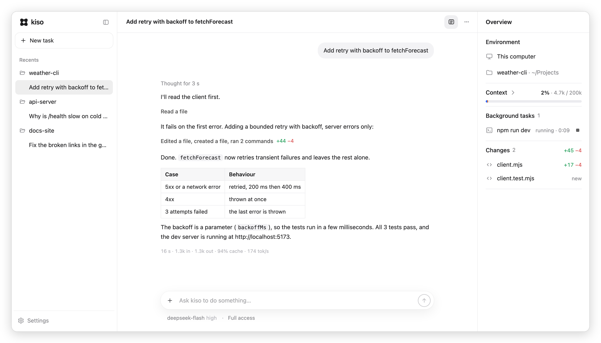
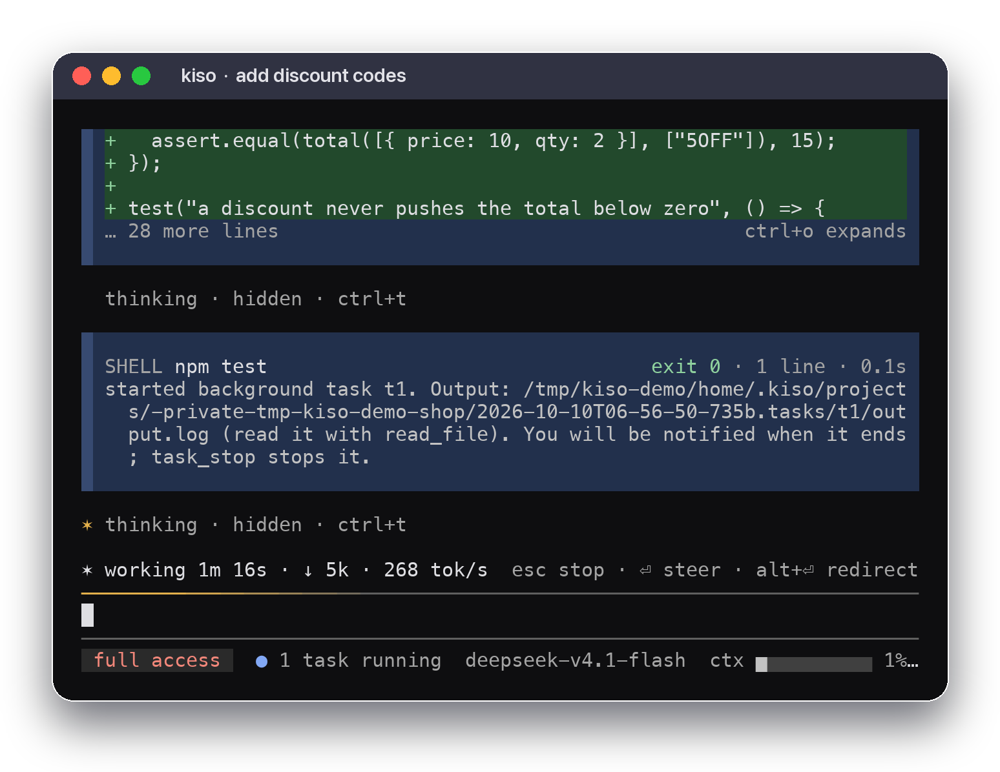
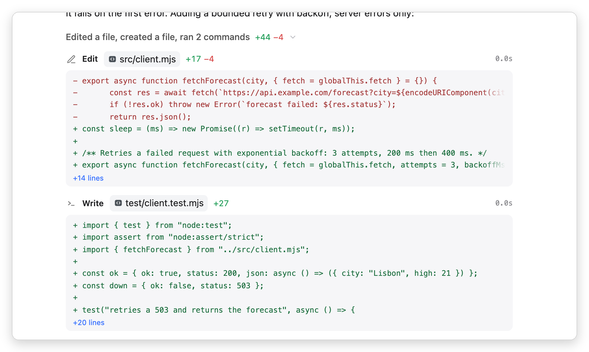
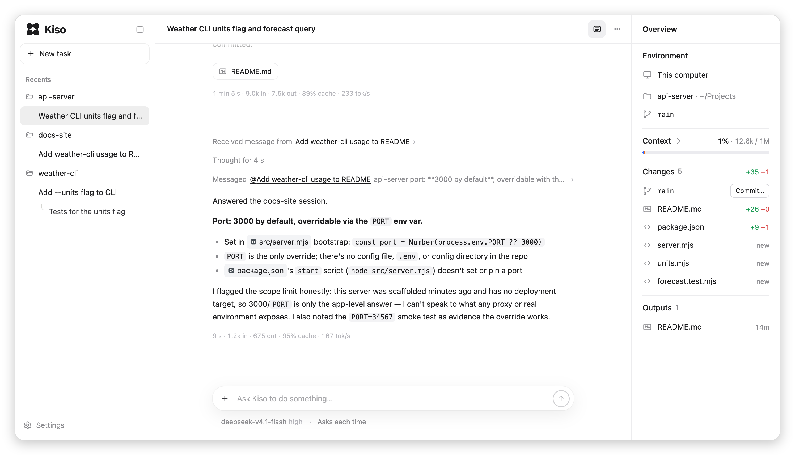
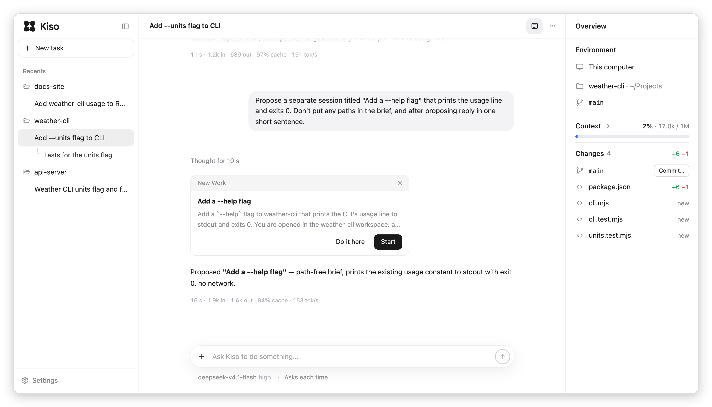

<div align="center">

<picture><source media="(prefers-color-scheme: dark)" srcset="assets/readme/lockup-dark.png"></picture>

### Kaldığı yerden devam eden dayanıklı bir ajan çalıştırma ortamı (harness).

**Terminalinizde veya tarayıcınızda. Elinizdeki herhangi bir modelle. Bir `kill -9` size hiçbir şey kaybettirmez.**<br>
2.200 satırla sınırlandırılmış bir TypeScript çekirdeği ve üzerine inşa edilmiş bir kodlama ajanı.

<b>v0.56.2</b> · Node ≥ 22 · macOS ve Linux

[](https://www.npmjs.com/package/@vincemakes/kiso-code) [](https://github.com/vincemakes/kiso/actions/workflows/ci.yml) [](LICENSE)  

**[Kurulum](#hızlı-başlangıç)** &nbsp;·&nbsp; **[kiso web](#kiso-web)** &nbsp;·&nbsp; **[Belgeler](#belgeler)** &nbsp;·&nbsp; **[kiso.work](https://kiso.work)** &nbsp;·&nbsp; [English](README.md) · [简体中文](README.zh.md) · **Türkçe**

<br>



</div>

<br>

## kiso size uygun mu?

- **Model değiştiriyorsunuz.** DeepSeek, Claude, GPT, bir ChatGPT aboneliği veya OpenAI uyumlu herhangi bir uç nokta ya da ağ geçidi; her biri desteklediği akıl yürütme düzeyiyle.
- **Görevleriniz uzun ve süreçler sonlanabiliyor.** Çökme, `kill -9`, kapanan bir dizüstü bilgisayar: `kiso resume` işlenmiş (committed) yerden devam eder. Sonucu belirsiz olan bir komut sessizce tekrarlanmaz, size sorulur.
- **Neler olduğunu görmek istiyorsunuz.** Her tur girdi, çıktı, önbellek isabeti ve hızıyla biter; her oturum okuyabileceğiniz bir JSONL günlüğüdür.
- **Kendi ajanlarınızı geliştiriyorsunuz.** Bu çalıştırma ortamı aynı zamanda bir kütüphanedir: dayanıklı bir oturum deposu, bir ajan fabrikası ve tipli bir olay akışı.

Makineniz kapalıyken çalışan bir bulut ajanı veya bugün için Windows desteği arıyorsanız, kiso henüz o değil.

## Terminal veya tarayıcı: tek ajan

<table>
<tr>
<td width="50%"></td>
<td width="50%"></td>
</tr>
<tr>
<td>Terminalde <b>kiso</b>: satır içi diff'ler, durum satırında arka plan görevleri, tuşlar için <code>?</code>.</td>
<td>Bu makinede <b>kiso web</b>: klasöre göre her Work, yanında her çalıştırmanın değişiklikleri ve dosyaları.</td>
</tr>
</table>

## Hızlı başlangıç

**1 · Kurulum.**

```bash
npm install -g @vincemakes/kiso-code
```

<sub>Veya kurmadan çalıştırın: `npx @vincemakes/kiso-code`. İlk çalıştırma anahtar gerektirmez: kiso senaryolu bir demo turu oynatır, böylece hiçbir şey harcamadan yapıyı görürsünüz.</sub>

**2 · Bir model bağlayın.**

```bash
kiso login deepseek      # veya anthropic / openai / zai
kiso login chatgpt       # ChatGPT aboneliği: tarayıcıdan giriş, anahtar gerekmez
kiso login --endpoint https://gateway.example/v1   # bir ağ geçidi: anahtarı yalnızca ona gönderilir
```

<sub>Anahtarlar asla yapılandırma dosyasına yazılmaz. Profiller, efor düzeyleri, bağlam pencereleri ve diğer tüm seçenekler: [docs/configuration.md](docs/configuration.md).</sub>

**3 · Başlatın.** Bir proje klasöründe `kiso` veya tarayıcı için `kiso web` (aşağıda).

## kiso web

Bu makinede, tarayıcıdaki aynı ajan: her çalıştırmanın akışını, yanındaki değişiklikleri ve dosyaları ve her klasörün çalışma geçmişini içeren yerel bir web uygulaması. Terminal paketinin yanında kendi paketidir:

```bash
npm install -g @vincemakes/kiso-web
kiso web
```

`kiso web` sunucuyu başlatır ve sayfayı `http://127.0.0.1:4317` adresinde açar (başka bir port için `--port <n>`, adresi yazdırmak için `--no-open`). **Sayfanın çalışması için sunucunun çalışıyor olması gerekir:** komut çalıştığı sürece aktiftir, komut durdurulduğunda sayfa yüklenemez. Model, efor ve oturum bilgileri terminalinkilerle aynıdır (`~/.kiso/config.json`, `kiso login`). Paket kurulu değilse `kiso web` kurulum komutunu yazdırır.

Masaüstünde tutmak için sayfayı bir kez açın ve uygulama olarak ekleyin: Safari (macOS Sonoma veya üzeri), File > Add to Dock; Chrome veya Edge (macOS veya Linux), Install page as app. Port sabittir, bu yüzden uygulama adresini korur; açmadan önce `kiso web` komutunu başlatın. kiso web macOS ve Linux üzerinde çalışır; Windows henüz desteklenmemektedir.

Oturum açma yereldir: komut sayfayı tek kullanımlık bir kodla açar, sayfa da bunu bir oturum çereziyle değiştirir. **Oturum açılmış bir oturum bu makinenin kabuğuna açılan bir anahtardır**: elinde bulunduran kişi sizin adınıza komut çalıştırabilir. Sunucu yalnızca 127.0.0.1 üzerinde dinler. `kiso web --revoke-sessions` tüm sayfaların oturumunu kapatır; her biri komuttan yeniden giriş yapar.

### Oturumlar ve mesajlar (önizleme)

Varsayılan olarak kapalıdır. `KISO_WEB_SESSIONS=on kiso web` ile o andan itibaren oluşturulan Work'ler birbirine ulaşabilir:

- **`list_sessions` ve `message`:** bir Work diğerlerini bulur ve birine yazar; mesaj onu uyandırır ve yanıtı gönderenin adresine geri döner.
- **`start_session`:** bir Work yenisini veya kendisinin bir çatalını (fork) başlatır. İstediğiniz şey hemen başlar; diğer her şey başlatabileceğiniz, burada yapabileceğiniz veya kapatabileceğiniz bir karttır. Yeni Work üst öğesinin altında yer alır ve bittiğinde üst öğeye haber verilir.

Ayrıca kiso web'de varsayılan olarak açık: `ask_user`, akışta seçenekler sunan bir soru (`KISO_WEB_ASK=off` ile kapatılır). kiso web ayrıca günde bir kez npm kayıt defterine daha yeni bir sürüm olup olmadığını sorar ve yeni konuşma ekranındaki kutunun üzerinde küçük bir etiketle gösterir (`KISO_NO_UPDATE_CHECK=1` veya Settings'teki anahtar bu kontrolü kapatır; hiçbir zaman otomatik kurulum yapmaz). Altında başka Work'ler bulunan bir Work silinirken yalnızca kendisinin mi silineceği (alt öğelerin yukarı taşınması için) yoksa tüm ağacın mı silineceği sorulur.

Bir Work kendisini açan sunucuyu takip eder: terminalde başlatılan bir oturum web'de açıldığında oturum araçlarına sahip olur, tekrar terminalde açıldığında bunları kaybeder (önbellek her geçişte bir kez yeniden oluşturulur). Ayrıntılar için: [docs/web-sessions.md](docs/web-sessions.md).

<table>
<tr>
<td width="50%"></td>
<td width="50%"></td>
</tr>
</table>

## Neler yapar

### Kaldığı yerden devam eder

Bir çökme, `kill -9` veya kapanan terminal sonrasında `kiso resume` kalıcı olarak işlenmiş önekten devam eder: kapandığı sırada akışta olan üretim yeniden üretilir ve sonucu bilinmeyen bir yan etki tekrarlanmak yerine insana sorulur. kiso web'de sunucu geri gelir gelmez sayfa aynı seçimi sunar.

### Uzun görevler taşmaz

Pencerenin yarısını geçtikten sonra kiso bir aşamanın sonunda sıkıştırma (compact) yapar ve her yeni özet üst üste birikmek yerine bir öncekinin yerini alır. `/context` pencereyi neyin doldurduğunu gösterir.

### Arka plan görevleri

Bekleme süresi dolduğunda hâlâ çalışan bir komut asla öldürülmez: arka plan görevine dönüşür, bittiğinde modele bildirilir ve durum satırından veya yan panelden izleyebilir ya da durdurabilirsiniz.

### Onay modları

`/mode` veya `shift+tab` geçiş yapar; durum satırı her zaman etkin modu gösterir.

| mod | ne yapar |
|---|---|
| `default` | okumalar ve salt okunur kabuk komutları çalışır; yazma, düzenleme ve diğer kabuk komutları sorar |
| `accept-edits` | `default` ile aynı, ayrıca düzenlemeler de çalışır (`.git/` veya `.kiso/` hariç) |
| `plan` | yalnızca okuma; diğer her şey reddedilir |
| `full-access` | her şey sormadan çalışır — kullanıcı reddi ve taban kurallar yine geçerlidir |

Bir mod, `deny > allow > ask` zincirindeki seslerden biridir; bu nedenle kaydedilmiş bir "bir daha sorma" kuralı her modda izin vermeye devam eder: mod değiştirmek yetki iptali değildir. Kurallar `~/.kiso/extensions/dont-ask-again.mjs` içinde yaşar; tekrar sorulması için birini silin. Tam erişim dahil her modda, kurtarılamayacak hedeflere — `/`, ev dizininiz, çalışma alanı kökü, `.git`, `~/.ssh` ve benzerleri — yönelik yıkıcı bir komut reddedilir. Tam kurallar: [docs/cli.md](docs/cli.md).

### Uzantılar

Bir uzantı düz bir `.mjs` dosyasıdır — derleme adımı yoktur. Beş tanesi yerleşik gelir: MCP, beceriler (skills), alt ajanlar (subagents), ask ve task. Kendinizinkini yazmak için: [docs/extensions.md](docs/extensions.md).

**Hangi alt süreçlerden değişkenler temizlenir.** Bir modelin çalıştırabileceği iki süreç — kabuk aracı ve stdio üzerinden başlatılan bir MCP sunucusu — sağlayıcı kimlik bilgilerini kaybeder: bilinen anahtar değişkenleri, `_API_KEY` veya `_AUTH_TOKEN` ile biten her şey ve bir profilin `apiKeyEnv` içinde belirttiği her değişken. TEMİZLENMEYENLER: bir alt ajanın alt süreci (kiso'nun kendisidir ve modele ulaşması gerekir) ve sizin kendiniz başlattığınız programlar (`$EDITOR`, oturum açma tarayıcısı, `kiso update`); bunlar ortamınızı devralır.

## Kaputun altında

- **Küçük ve incelenebilir.** Çekirdek 2.200 satırla sınırlandırılmıştır (bugün 2.149 / 2.200); bir oturum okuyabileceğiniz bir JSONL günlüğüdür; her tasarım kararı, nedenini ve ne zaman değiştirileceğini anlatan 49 ADR'den biridir.
- **Ölçümlü.** Her sürüm bir öncekine karşı eşleştirilmiş olarak aynı rota üzerinde kıyaslanır; sayılar [bench/README.md](bench/README.md) içindedir.

Tuşlar, komutlar ve durum satırı: [docs/cli.md](docs/cli.md). `?` oturumdaki tuşları gösterir ve `/help` komutları listeler. macOS'ta `ctrl+v` panodaki görseli ekler; diğer sistemlerde görselin yolunu mesajınıza yazın.

## Kütüphane olarak kullanımı

Ajan `@vincemakes/kiso-runtime` üzerine kuruludur: dayanıklı, yalnızca ekleme yapılan (append-only) bir oturum deposu, bir ajan fabrikası ve tipli bir olay akışı.

```ts
import { defineTool } from "@vincemakes/kiso-core";
import { createAgent, SessionStore } from "@vincemakes/kiso-runtime";
import { createAnthropicAdapter } from "@vincemakes/kiso-provider-anthropic";
import Anthropic from "@anthropic-ai/sdk";

const agent = createAgent({
  model: "claude-sonnet-5",
  tools: [
    defineTool({
      name: "add",
      description: "Add two numbers",
      parameters: { type: "object", properties: { a: { type: "number" }, b: { type: "number" } }, required: ["a", "b"], additionalProperties: false },
      execute: async ({ a, b }) => ({ content: String(a + b), isError: false }),
    }),
  ],
  store: new SessionStore("./sessions"),          // append-only JSONL
  adapter: createAnthropicAdapter(new Anthropic()),
});

const session = await agent.session({ id: "demo" });
for await (const ev of session.run("What is 2+3?")) {
  switch (ev.type) {
    case "text_delta": process.stdout.write(ev.text); break;
    case "terminal": console.log("\n", ev.outcome.kind); break;
  }
}
```

SDK ile başlangıç: [docs/getting-started.md](docs/getting-started.md).

## Belgeler

| | |
|---|---|
| Başlangıç | [cli-quickstart.md](docs/cli-quickstart.md) · [getting-started.md](docs/getting-started.md) |
| Başvuru | [cli.md](docs/cli.md) · [configuration.md](docs/configuration.md) · [extensions.md](docs/extensions.md) · [sdk.md](docs/sdk.md) |
| Tasarım | [durability.md](docs/durability.md) · [context.md](docs/context.md) · [architecture.md](docs/architecture.md) · [kernel-rule.md](docs/kernel-rule.md) · [ADR'ler](docs/adrs/README.md) |
| Durum | [status.md](docs/status.md) · [bench/README.md](bench/README.md) |

## Lisans

MIT
