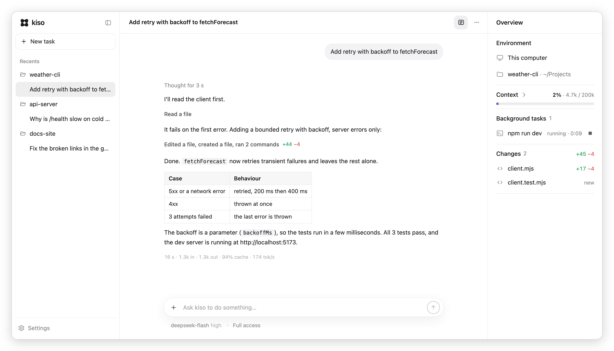
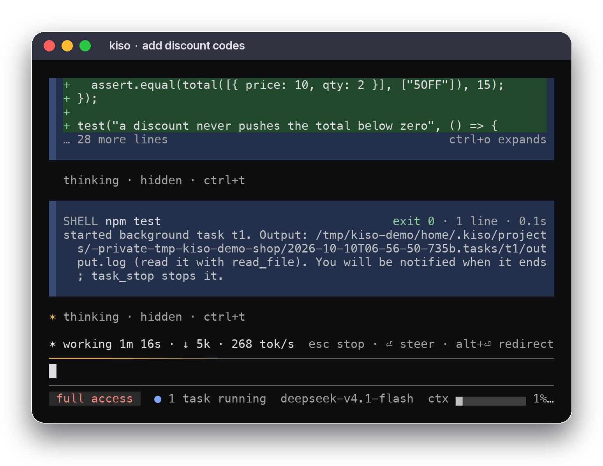
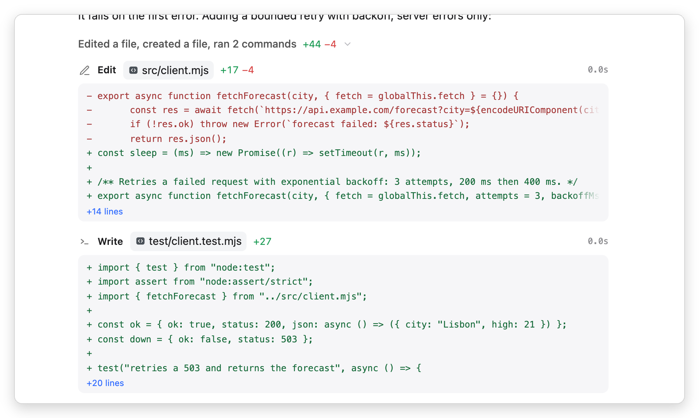

<div align="center">

<picture><source media="(prefers-color-scheme: dark)" srcset="assets/readme/lockup-dark.png"></picture>

### 断了能接着做的编程助手。

**终端里用，浏览器里也能用。哪家的模型都能接。`kill -9` 也不丢东西。**<br>
底层是一个持久的 agent 运行时，内核上限 2,200 行。

<b>v0.54.0</b> · Node ≥ 22 · macOS 和 Linux

[](https://www.npmjs.com/package/@vincemakes/kiso-code) [](https://github.com/vincemakes/kiso/actions/workflows/ci.yml) [](LICENSE)  

**[安装](#快速开始)** &nbsp;·&nbsp; **[kiso web](#kiso-web)** &nbsp;·&nbsp; **[文档](#文档)** &nbsp;·&nbsp; **[kiso.work](https://kiso.work)** &nbsp;·&nbsp; [English](README.md) · **简体中文**

<br>



</div>

<br>

## kiso 适合你吗

- **你会换模型。** DeepSeek、Claude、GPT、ChatGPT 订阅，或任何 OpenAI 兼容的端点和网关，每个都能用它支持的推理强度。
- **你的任务很长，进程会死。** 崩溃、`kill -9`、合上笔记本：`kiso resume` 从已提交的地方接着做。结果不确定的命令交给你决定，绝不悄悄重做。
- **你想看清它在干什么。** 每轮结束都显示输入、输出、缓存命中和速度；每个会话都是一份可以直接读的 JSONL 日志。
- **你自己也在做 agent。** 它底下的运行时就是一个库：持久的会话存储、agent 工厂和带类型的事件流。

如果你要的是机器关着也能干活的云端 agent，或者现在就要在 Windows 上用，kiso 暂时还不是。

## 终端或浏览器，同一个助手

<table>
<tr>
<td width="50%"></td>
<td width="50%"></td>
</tr>
<tr>
<td><b>kiso</b> 在终端里：diff 直接显示，后台任务在状态栏，按 <code>?</code> 看按键。</td>
<td><b>kiso web</b> 在这台机器的浏览器里：按文件夹列出每个 Work，每次运行改了什么、产出了什么都在旁边。</td>
</tr>
</table>

## 快速开始

**1 · 安装。**

```bash
npm install -g @vincemakes/kiso-code
```

<sub>不想安装可以直接 `npx @vincemakes/kiso-code`。第一次运行不需要密钥：kiso 会先用内置脚本演示一轮完整流程，不花一分钱。</sub>

**2 · 接入模型。**

```bash
kiso login deepseek      # 也可以是 anthropic / openai / zai
kiso login chatgpt       # ChatGPT 订阅：浏览器登录，不需要密钥
kiso login --endpoint https://gateway.example/v1   # 网关：密钥只发给这个网关
```

<sub>密钥从不写进配置文件。模型档、思考档位、上下文窗口等全部选项见 [docs/configuration.md](docs/configuration.md)。</sub>

**3 · 开始。** 在项目文件夹里运行 `kiso`，或者运行 `kiso web` 用浏览器（见下）。

## kiso web

同一个助手，在这台机器的浏览器里：一个本地网页应用，显示每次运行的过程、旁边是它改的文件和产出，以及所有文件夹的工作历史。它是单独的包，和终端版并列安装：

```bash
npm install -g @vincemakes/kiso-web
kiso web
```

`kiso web` 启动宿主并打开 `http://127.0.0.1:4317` 上的页面（`--port <n>` 换端口，`--no-open` 只打印地址）。**页面要能用，宿主必须在运行：** 命令运行多久宿主就运行多久，命令停了页面就打不开。模型、推理强度和登录都沿用终端版的（`~/.kiso/config.json`、`kiso login`）。没装这个包时，`kiso web` 会打印安装命令。

想放在桌面上：先打开一次页面，再把它添加为应用。Safari（macOS Sonoma 及以上）：文件 > 添加到程序坞；Chrome 或 Edge（macOS 或 Linux）：将此页面作为应用安装。端口是固定的，所以应用地址不会变；打开它之前先运行 `kiso web`。kiso web 支持 macOS 和 Linux；暂不支持 Windows。

登录只在本机进行：命令用一次性代码打开页面，页面用它换取会话 cookie。**已登录的会话就是这台机器 shell 的钥匙**：拿到它的人可以用你的身份执行命令。宿主只监听 127.0.0.1。`kiso web --revoke-sessions` 让所有页面退出登录，之后每个页面都要再从命令登录一次。

## 它能做什么

### 断了能接着做

进程崩溃、`kill -9`、关掉终端之后，`kiso resume` 从已提交的持久前缀继续：中断时还没生成完的内容会重新生成，结果不确定的操作交给人决定，绝不自动重做。在 kiso web 里，宿主一恢复，页面就会给出同样的选择。

### 长任务不爆上下文

用到窗口一半时，kiso 在一个阶段结束后自动压缩，新摘要替换旧摘要，不会越压越多。`/context` 看上下文被什么占着。

### 后台任务

等待时间到了还没跑完的命令不会被杀掉：它变成后台任务，结束时模型会收到通知，你可以在状态栏或右侧栏查看或停止它。

### 审批模式

`/mode` 或 `shift+tab` 切换，状态栏始终显示当前模式。

| 模式 | 行为 |
|---|---|
| `default` | 读文件和只读命令直接放行；写文件、改文件、其他命令先问你 |
| `accept-edits` | 在 `default` 基础上，改文件也直接放行（`.git/`、`.kiso/` 除外） |
| `plan` | 只能读，其他一律拒绝 |
| `full-access` | 全部放行，不再询问；你的拒绝规则和底线照样生效 |

模式只是 `deny > allow > ask` 这条链里的一票：保存过的“不再询问”规则在任何模式下都照样放行，切换模式不会撤销它。这些规则存在 `~/.kiso/extensions/dont-ask-again.mjs`，删掉一条就会重新询问。无论哪种模式，包括 `full-access`，指向删了就无法恢复的位置的破坏性命令都会被拒绝：`/`、你的家目录、工作区根目录、它的 `.git`、`~/.ssh` 这类。完整规则见 [docs/cli.md](docs/cli.md)。

### 扩展

扩展就是一个普通的 `.mjs` 文件，不需要构建。内置了五个：MCP、技能、子代理、提问和任务清单。写自己的扩展见 [docs/extensions.md](docs/extensions.md)。

**哪些子进程会被剥离凭据。** 模型能触发运行的两类：shell 工具，以及用 stdio 启动的 MCP 服务器。它们拿不到模型商的凭据：已知的密钥变量、以 `_API_KEY` 或 `_AUTH_TOKEN` 结尾的变量、以及模型档 `apiKeyEnv` 指定的变量都会被去掉。不剥离的：subagent 的子进程（它就是 kiso 本身，要连模型），以及你自己启动的程序（`$EDITOR`、登录用的浏览器、`kiso update`），它们照常继承你的环境。

## 底层

- **小而透明。** 内核上限 2,200 行（现在 2,194 行）；会话就是一份可以直接读的 JSONL 日志；每个设计决定都记在 46 份 ADR 里，写明为什么这样做、什么情况下该推翻它。
- **每版都实测。** 每次发版都和上一版在同一条路由上做配对测试，数字见 [bench/README.md](bench/README.md)。

按键、命令和状态栏的完整说明见 [docs/cli.md](docs/cli.md)。会话里按 `?` 看按键，`/help` 看命令。`ctrl+v` 贴剪贴板里的图片（仅 macOS；其他系统请在消息里写上图片的路径）。

## 使用方式

这个助手建在 `@vincemakes/kiso-runtime` 之上：一个持久的、只追加的会话存储，一个 agent 工厂，和一条带类型的事件流。

```ts
import { defineTool } from "@vincemakes/kiso-core";
import { createAgent, SessionStore } from "@vincemakes/kiso-runtime";
import { createAnthropicAdapter } from "@vincemakes/kiso-provider-anthropic";
import Anthropic from "@anthropic-ai/sdk";

const agent = createAgent({
  model: "claude-sonnet-5",
  tools: [
    defineTool({
      name: "add",
      description: "Add two numbers",
      parameters: { type: "object", properties: { a: { type: "number" }, b: { type: "number" } }, required: ["a", "b"], additionalProperties: false },
      execute: async ({ a, b }) => ({ content: String(a + b), isError: false }),
    }),
  ],
  store: new SessionStore("./sessions"),          // append-only JSONL
  adapter: createAnthropicAdapter(new Anthropic()),
});

const session = await agent.session({ id: "demo" });
for await (const ev of session.run("What is 2+3?")) {
  switch (ev.type) {
    case "text_delta": process.stdout.write(ev.text); break;
    case "terminal": console.log("\n", ev.outcome.kind); break;
  }
}
```

SDK 入门见 [docs/getting-started.md](docs/getting-started.md)。

## 文档

| | |
|---|---|
| 上手 | [cli-quickstart.md](docs/cli-quickstart.md) · [getting-started.md](docs/getting-started.md) |
| 参考 | [cli.md](docs/cli.md) · [configuration.md](docs/configuration.md) · [extensions.md](docs/extensions.md) · [sdk.md](docs/sdk.md) |
| 设计 | [durability.md](docs/durability.md) · [context.md](docs/context.md) · [architecture.md](docs/architecture.md) · [kernel-rule.md](docs/kernel-rule.md) · [ADR](docs/adrs/README.md) |
| 现状 | [status.md](docs/status.md) · [bench/README.md](bench/README.md) |

## 许可

MIT
